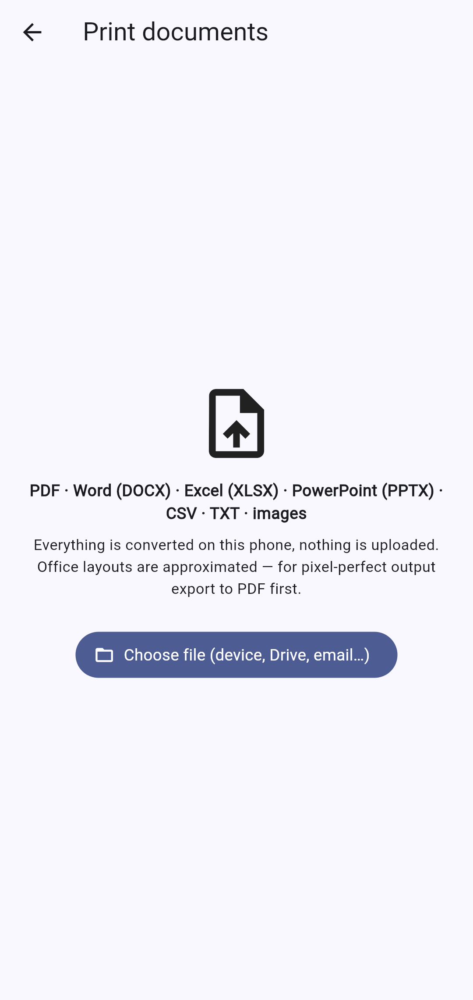
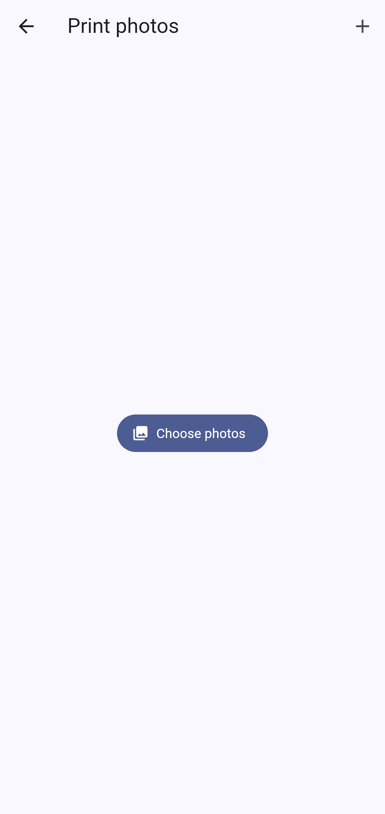

# SmartPrint

Free, fully offline Android app to print documents, photos, web pages and scans to almost any WiFi printer, with **on-device AI** (OCR, summarize, translate). No account, no ads, no paywall, nothing uploaded.

| Home | Documents | Photos | Web to PDF | History |
|:-:|:-:|:-:|:-:|:-:|
|  |  |  |  |  |

## Features
- **Documents**: PDF, images, and on-device conversion of DOCX, XLSX, PPTX, CSV, TXT (see limits below).
- **Photos & scans**: multi-select, reorder (drag), crop, rotate, filters, auto-enhance, undo; 1/2/4/6/9 per sheet, fit or fill, borderless.
- **Scanner**: ML Kit Document Scanner (edge detection, perspective crop, multi-page) to PDF.
- **Web pages**: URL to PDF via Android WebView print engine.
- **Preview**: paper size (A4, Letter, A5, Legal, 4x6"), orientation, share PDF.
- **Printing**: Android print framework (Mopria / IPP / vendor plugins: copies, page range, colour in the system dialog), or direct IPP to printers discovered by mDNS (`_ipp._tcp`) with copies.
- **On-device AI**: ML Kit OCR; Gemma 3 1B / Gemma 3n `.task` via MediaPipe LLM Inference (`flutter_gemma`) for summarize & translate. Model downloads once on first use (Gemma is gated: accept its license on Hugging Face and paste a token in the AI screen); then works offline.
- **History**: stored locally only.

## Office conversion limits (offline, best-effort)
| Format | Supported | Not supported |
|---|---|---|
| DOCX | paragraphs, headings/title, bold/italic/underline/size/colour, alignment, bullet/numbered lists (as bullets), tables, inline PNG/JPEG images, page breaks | exact fonts & spacing, headers/footers, footnotes, text boxes, floating images, charts, SmartArt, EMF/WMF, columns, merged-cell spans |
| XLSX | all sheets as tables (strings, numbers, booleans, cached formula results), up to 3000 rows × 40 columns, auto landscape | cell formatting/colours, number formats/dates (raw values), merged cells, charts, images |
| PPTX | one page per slide at slide size, text boxes & placeholders positioned by frame, font size/bold/italic/colour, pictures | themes/backgrounds, layout-inherited positions (approximated), shapes/fills, group offsets, charts, animations |
| CSV / TXT | full | — |
| DOC / XLS / PPT / ODT / RTF | — | legacy/binary formats: export to DOCX/PDF first |

Fonts: bundled Roboto (Latin incl. Vietnamese). CJK text in Office files will not render.

## Build
```bash
cd mobile && flutter pub get && flutter test
flutter build apk --release --target-platform android-arm64 --split-per-abi
```
Stack: Flutter · Riverpod · go_router · `pdf`/`printing` · ML Kit · MediaPipe (Google AI Edge).

`legacy-backend/` holds the earlier NestJS API (auth, sync, server-side conversion). The app no longer uses it.
