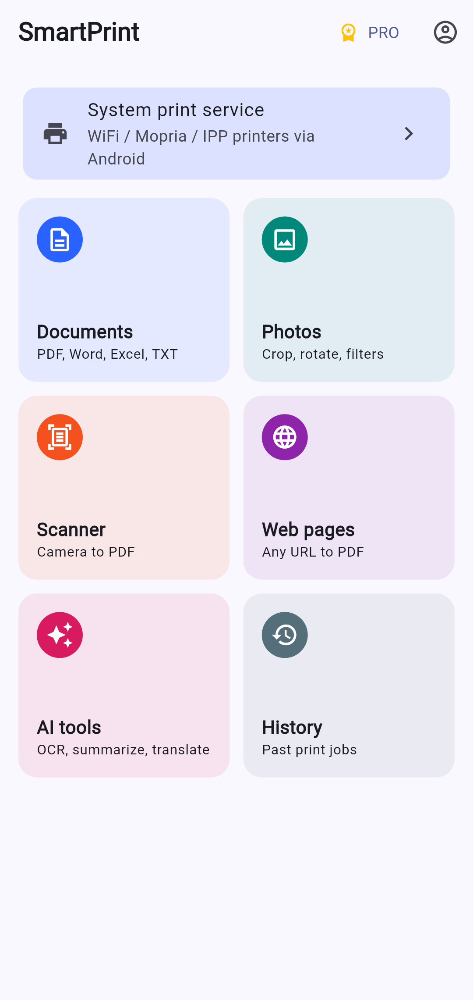
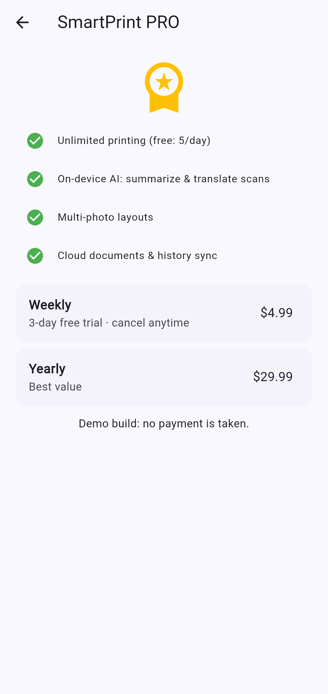
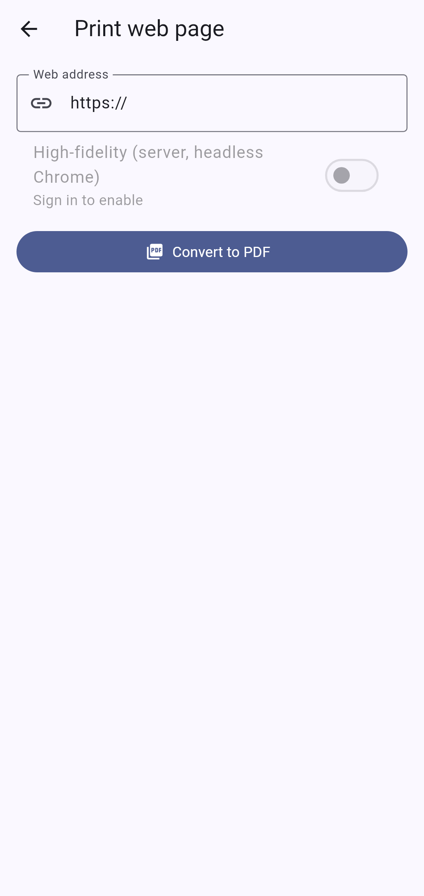
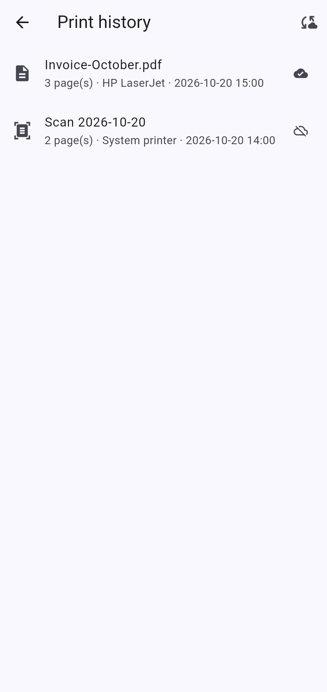

# SmartPrint

Print documents, photos, web pages and scans from Android to almost any WiFi printer, with **on-device AI** (OCR, summarize, translate) powered by Google AI Edge.

| Home | Paywall | Web to PDF | History |
|:-:|:-:|:-:|:-:|
|  |  |  |  |

## Features
- **Documents**: PDF, images, TXT on-device; Word/Excel/PowerPoint converted server-side (LibreOffice headless).
- **Photos**: multi-select, crop, rotate, filters, auto-enhance, 1/2/4 per sheet.
- **Web pages**: URL to PDF on-device (WebView) or on the server (headless Chrome).
- **Scanner**: ML Kit Document Scanner (edge detection, perspective crop, multi-page) to PDF.
- **Printing**: Android print framework (Mopria / IPP / vendor plugins), or direct IPP to printers discovered by mDNS (`_ipp._tcp`).
- **On-device AI**: ML Kit OCR; Gemma 3 1B / Gemma 3n `.task` via MediaPipe LLM Inference (`flutter_gemma`) for summarize & translate. Models download on first use (Gemma is gated: accept the license on Hugging Face and paste a token in the AI screen).
- **History** (local, synced when signed in), **PRO paywall placeholder** (no real billing; 5 free prints/day).

## Stack
| Layer | Tech |
|---|---|
| Mobile | Flutter · Riverpod · go_router |
| Backend | NestJS · Prisma · PostgreSQL · LibreOffice · Chromium |
| Storage | Local disk or any S3-compatible bucket |

## Quick start
```bash
# Backend
docker compose up -d --build            # API http://localhost:3000, Swagger /docs
# or locally
cd backend && cp .env.example .env && npm ci && npx prisma migrate deploy && npm run start:dev
npm test                                # e2e tests (needs Postgres; DATABASE_URL to a test DB)

# Mobile
cd mobile && flutter pub get
flutter build apk --release --target-platform android-arm64 --split-per-abi --dart-define=API_URL=http://<server>:3000
```

## API
`POST /auth/register|login` · `GET|PATCH /me` · `GET /jobs`, `POST /jobs/sync`, `DELETE /jobs/:id` · `GET|POST /documents`, `GET /documents/:id/content`, `DELETE /documents/:id` · `POST /convert/office` (multipart `file`) · `POST /convert/web` (`{url}`, SSRF-guarded) · `GET /subscription` (stub).

## Not yet
Real Google Play Billing, template library, iOS polish.
